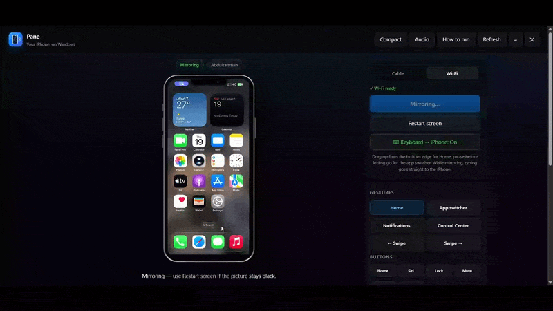

<p align="center">
  
</p>

<h1 align="center">Pane</h1>

<p align="center">
  <b>Mirror and control an iPhone from Windows.</b>
</p>

<p align="center">
  <a href="https://github.com/teyboxv1/pane-iphone-mirror-windows/releases/latest"></a>
  
  
</p>

<p align="center">
  
</p>

Pane is iPhone screen mirroring for Windows, a scrcpy for iPhone: the phone's screen on the PC, controlled with the mouse and keyboard, with no jailbreak, no Mac, and no app installed on the phone. Video and input stay on your own computer.

Live video needs **iOS / iPadOS 27 or newer**. On iOS 26 and older the phone can connect, but it sends no picture.

It focuses on:

* **lightness** — one portable `Pane.exe`, no installer and no account
* **picture** — the iPhone display as a live HEVC stream, decoded in the browser
* **control** — mouse taps and swipes, keyboard typing, and the hardware buttons
* **privacy** — no cloud, no telemetry, no internet account
* **freedom** — free and open source

Its features include:

* USB mirroring
* Wi-Fi mirroring after a one-time cable pairing
* tap, long-press, drag, and swipe
* keyboard input, including Ctrl+C / Ctrl+V / Ctrl+A / Ctrl+Z as the matching shortcuts
* Home, App Switcher, Lock, Siri, volume, mute, Notification Center, and Control Center
* fit, zoom, rotate, and full-screen touch view
* restart if the picture stalls

## Prerequisites

The iPhone or iPad must run **iOS / iPadOS 27 or newer**. That is the minimum for a picture.

**Developer Mode** must be on: *Settings → Privacy & Security → Developer Mode*.

On **iOS 26 and older** the phone can still connect, and touch or keyboard input may work, but Apple does not send video frames. The screen stays black. Update to iOS 27 or newer for a picture.

You also need:

* Windows 10 or Windows 11 (64-bit)
* [Apple Devices](https://apps.microsoft.com/detail/9np83lwlpz9k) (or iTunes) from the Microsoft Store, for the USB driver
* Google Chrome or Microsoft Edge, which Pane uses as its window

Unlock the iPhone and tap **Trust This Computer** the first time you plug it in.

## Get the app

**Windows**

Download [`Pane.exe`](https://github.com/teyboxv1/pane-iphone-mirror-windows/releases/latest) from the latest release and run it. No Python install is required for the executable.

**From source**

```powershell
git clone https://github.com/teyboxv1/pane-iphone-mirror-windows.git
cd pane-iphone-mirror-windows
pip install -r requirements.txt
python -m handset.server
```

Open http://127.0.0.1:8765

**Build `Pane.exe`**

```powershell
pip install pyinstaller pillow
powershell -ExecutionPolicy Bypass -File packaging\build.ps1
```

The executable is written to `dist\Pane.exe`.

## Must-know tips

* Plug in the cable and choose **Cable** for the first connection. That is the stable path.
* Choose **Wi-Fi** only after **Set up Wi-Fi**, with the cable unplugged, the phone unlocked, and both devices on the same private network.
* A VPN, or a router that isolates wireless clients, hides the iPhone from Wi-Fi discovery. USB does not use that discovery.
* Right-click on the mirror sends Home.
* Drag up from the bottom edge for Home. Pause before release for the App Switcher.
* Quit Camera, Voice Memos, or any app using the microphone before you start. iOS will not stream the display while one of those is in front.

## Controls

| On the PC | On the iPhone |
| --- | --- |
| Left click / drag | Tap / swipe |
| Right click | Home |
| Keyboard | Types into the focused field |
| Ctrl+C / V / X / A / Z | Copy / Paste / Cut / Select all / Undo |
| Side buttons on the frame | Lock, volume, mute |

## How it works

Pane uses [pymobiledevice3](https://github.com/doronz88/pymobiledevice3) to open the same kind of tunnel Xcode uses, over USB or over Wi-Fi after pairing. On iOS 27 or newer the phone sends the display as HEVC. Chrome or Edge decodes it. Touches, buttons, and keystrokes go back as HID events. Everything listens on `127.0.0.1`.

```
iPhone ── USB or Wi-Fi ──▶ Pane ──▶ window (video + input)
```

## FAQ

**Does it work on iOS 26?**
No picture. iOS 27 is the minimum for video. Older versions can connect and may accept input, but they do not send frames.

**Do I need a jailbreak or a Mac?**
No.

**Does it work without a cable?**
Yes, after one USB pairing, on the same Wi-Fi, with the iPhone unlocked.

**Is anything uploaded?**
No. The video and input stay between the iPhone and the PC.

**Windows SmartScreen warns about `Pane.exe`.**
The file is not code-signed yet. Choose *More info → Run anyway*, or build it from source.

## Contact

Open a [GitHub issue](https://github.com/teyboxv1/pane-iphone-mirror-windows/issues) for bug reports and questions. For a black screen, check the iOS version first.

## License

Copyright (C) Pane contributors

Pane is licensed under the [GNU General Public License v3.0](LICENSE).

Not affiliated with or endorsed by Apple Inc. iPhone, iPad, iOS, and iPadOS are trademarks of Apple Inc.
